<div align="center">


# Робочий календар

**Безкоштовний додаток для Android, який веде календар робочих змін,<br>рахує відпрацьовані години та формує офіційні PDF-звіти.**

[](https://github.com/MNJMARIA/work-calendar/actions/workflows/release.yml)
[](https://github.com/MNJMARIA/work-calendar/releases/latest)


[](#ліцензія)

</div>

<p align="center">
  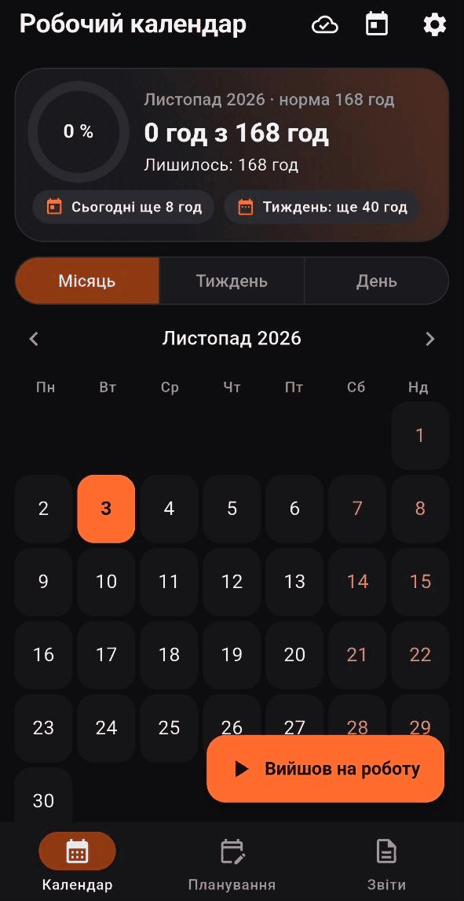
  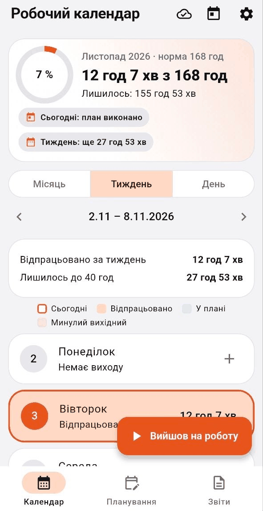
  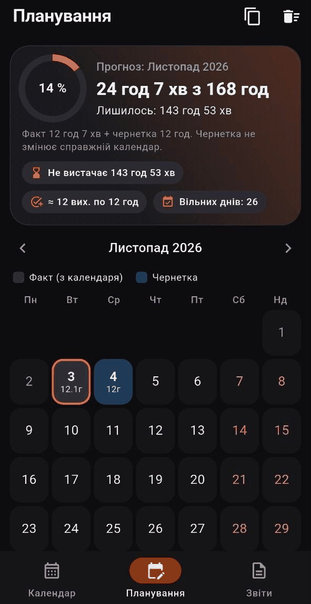
  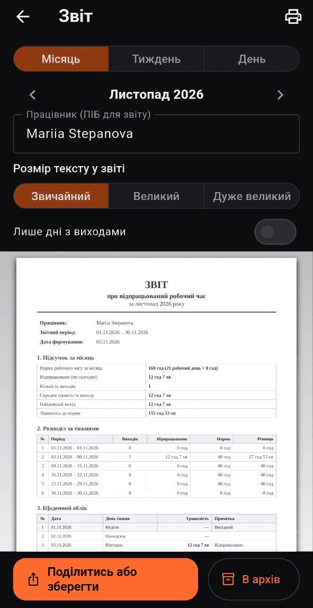
</p>

## Для кого цей додаток

Для людей, які працюють за змінним графіком (наприклад, доба/троє або 12-годинні зміни)
і хочуть без таблиць і калькулятора бачити головне:

- скільки годин уже відпрацьовано з місячної норми і скільки лишилось;
- які зміни були й які заплановані;
- готовий звіт для керівника, який можна переслати або роздрукувати.

Додаток працює **повністю офлайн** і без реєстрації. Акаунт потрібен лише якщо ви хочете
синхронізувати дані між телефонами: тоді вони шифруються на пристрої, і прочитати їх
не може ніхто, крім вас.

## Можливості

### Календар

Три вигляди: **Місяць**, **Тиждень**, **День**. Зверху завжди видно прогрес місяця:
відпрацьовано годин, норма, відсоток і скільки лишилось, а також скільки ще треба
сьогодні й за тиждень.

<table>
  <tr>
    <td align="center"><br><sub><b>Місяць</b><br>темна тема</sub></td>
    <td align="center">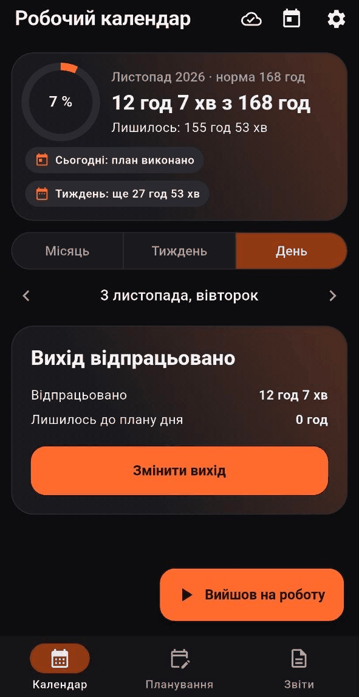<br><sub><b>День</b><br>вихід відпрацьовано</sub></td>
    <td align="center"><br><sub><b>Тиждень</b><br>світла тема</sub></td>
    <td align="center">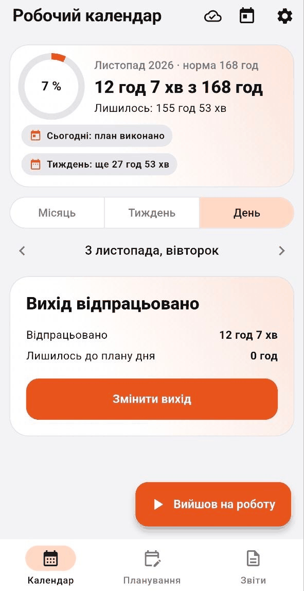<br><sub><b>День</b><br>світла тема</sub></td>
  </tr>
</table>

- Норма місяця = кількість будніх днів × 8 год (листопад 2026 → 168 год).
- Тиждень починається з понеділка; сьогоднішній день виділено рамкою.
- Майбутні виходи вважаються **планом** і не додаються до відпрацьованих годин.
- Світла й темна тема (або за налаштуваннями телефона).
- Усе зберігається на телефоні й працює в режимі польоту.

### Зміни: швидко й зручно

<table>
  <tr>
    <td align="center">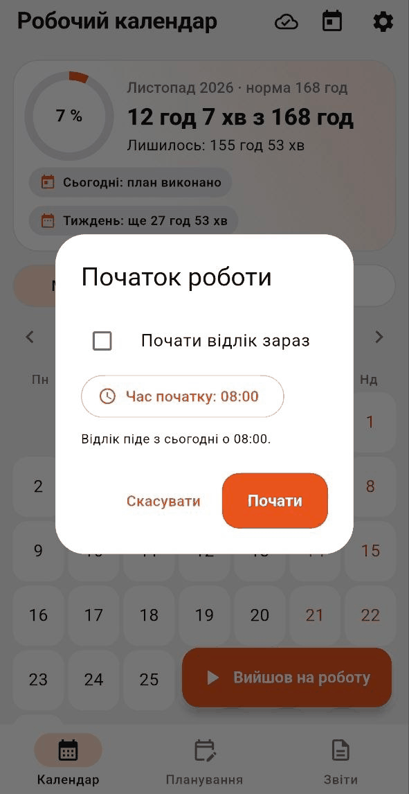<br><sub><b>«Вийшов на роботу»</b><br>початок зміни</sub></td>
    <td align="center">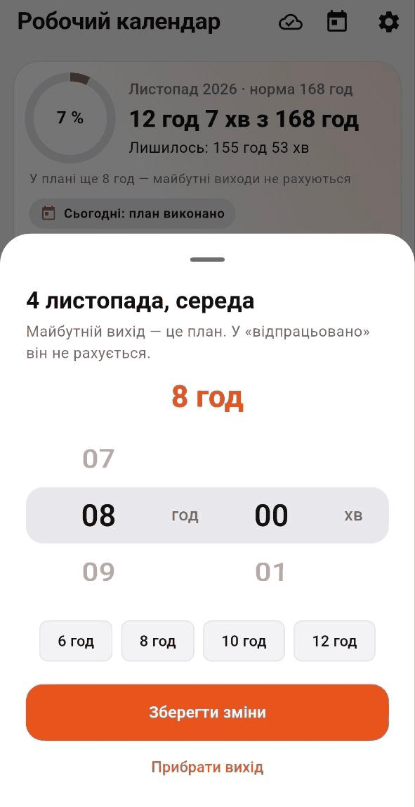<br><sub><b>Тривалість виходу</b><br>колеса годин і хвилин</sub></td>
    <td align="center">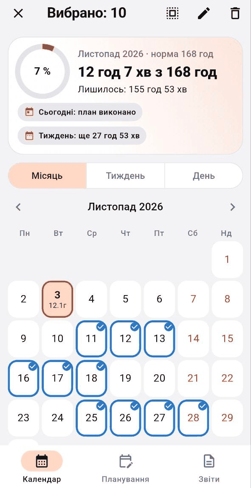<br><sub><b>Масовий вибір днів</b><br>змінити або прибрати</sub></td>
  </tr>
</table>

- **«Вийшов на роботу»**: одна кнопка; можна одразу почати відлік або вказати час початку.
- **Тривалість** задається колесами «год» і «хв», є швидкі кнопки 6 / 8 / 10 / 12 год.
- Натисніть на будь-який день, щоб додати, змінити або прибрати вихід.
- **Масовий вибір**: довге натискання на день, далі позначити кілька днів і змінити
  чи видалити їх разом.
- Стандартну тривалість виходу (за замовчуванням 12 год) можна змінити в налаштуваннях.

### Планування

Вкладка «Планування» — це **чернетка**: можна розставити майбутні зміни й одразу побачити
прогноз за місяць, не змінюючи справжній календар.

<table>
  <tr>
    <td align="center"><br><sub><b>Прогноз місяця</b><br>факт + чернетка</sub></td>
    <td align="center">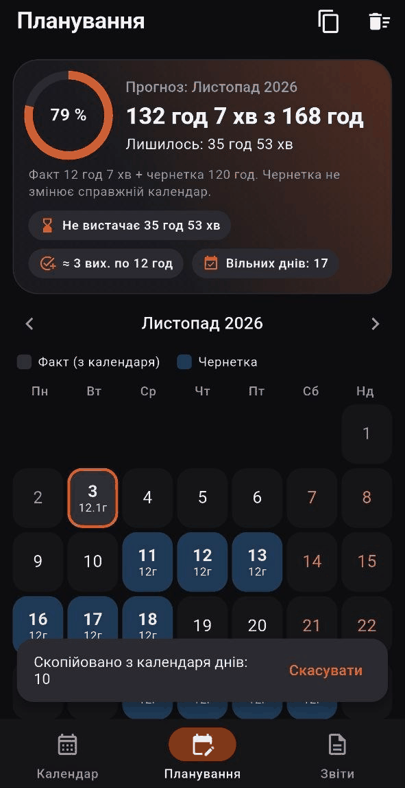<br><sub><b>Копіювання</b><br>з календаря в чернетку</sub></td>
    <td align="center">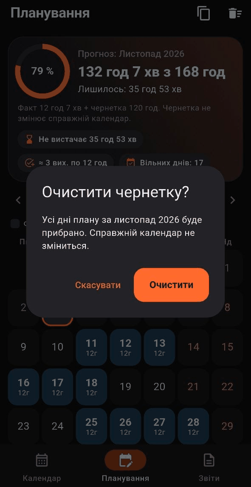<br><sub><b>Очистити чернетку</b><br>календар не зміниться</sub></td>
  </tr>
</table>

- Прогноз: «132 год з 168 год», скільки ще не вистачає, скільки виходів по 12 год це становить
  і скільки лишається вільних днів.
- Можна скопіювати вибрані дні з календаря у чернетку або очистити її одним дотиком.

### Звіти

Вкладка «Звіти» формує **офіційний PDF-документ** про відпрацьований робочий час:
заголовок, підсумок, розподіл за тижнями, щоденний облік і місця для підписів
працівника та керівника.

<table>
  <tr>
    <td align="center"><br><sub><b>Звіт за місяць</b></sub></td>
    <td align="center">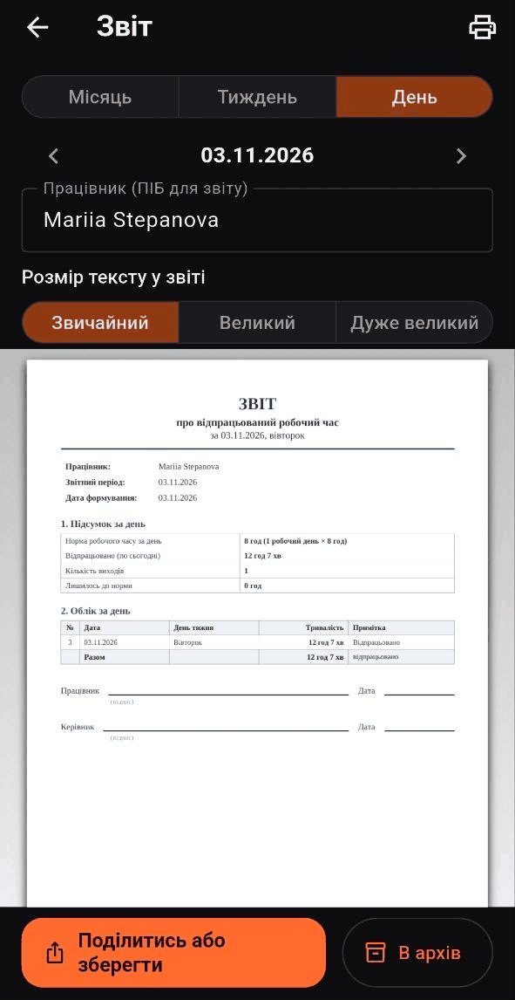<br><sub><b>Звіт за день</b></sub></td>
    <td align="center">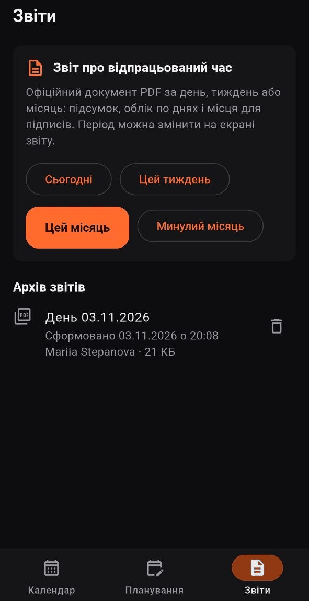<br><sub><b>Архів звітів</b><br>темна тема</sub></td>
    <td align="center">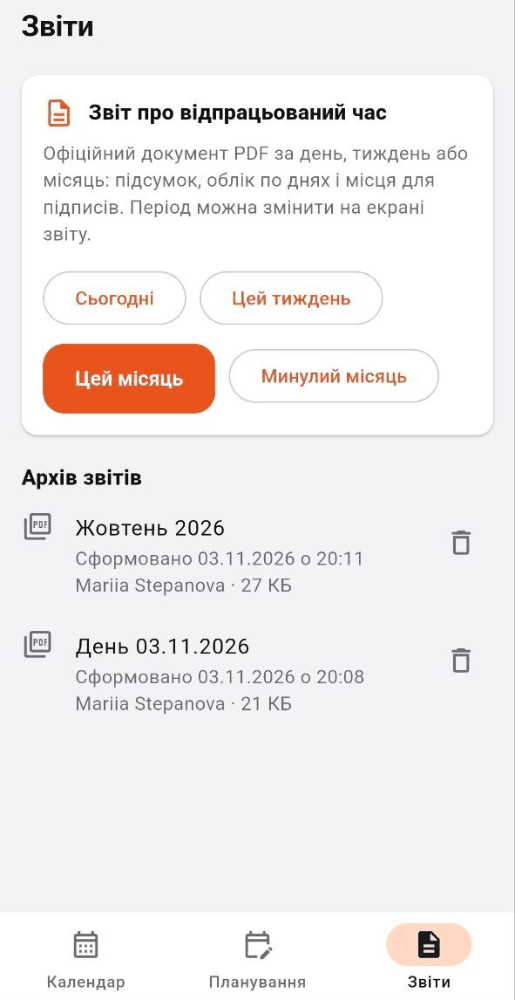<br><sub><b>Архів звітів</b><br>світла тема</sub></td>
  </tr>
</table>

- Період: **день**, **тиждень** або **місяць**, стрілками можна гортати періоди.
- Три розміри тексту: звичайний, великий, дуже великий.
- Перемикач «Лише дні з виходами» для короткого звіту.
- **Поділитись або зберегти**: Telegram, пошта, «Зберегти у файли»; кнопка **Друк**.
- **Архів**: кожен збережений звіт лежить на телефоні з датою й часом формування,
  іменем і розміром. Його можна відкрити, переслати, надрукувати або видалити.
- Документ використовує вільний шрифт Liberation Serif з повною підтримкою української.

### Налаштування, нагадування та акаунт

<table>
  <tr>
    <td align="center">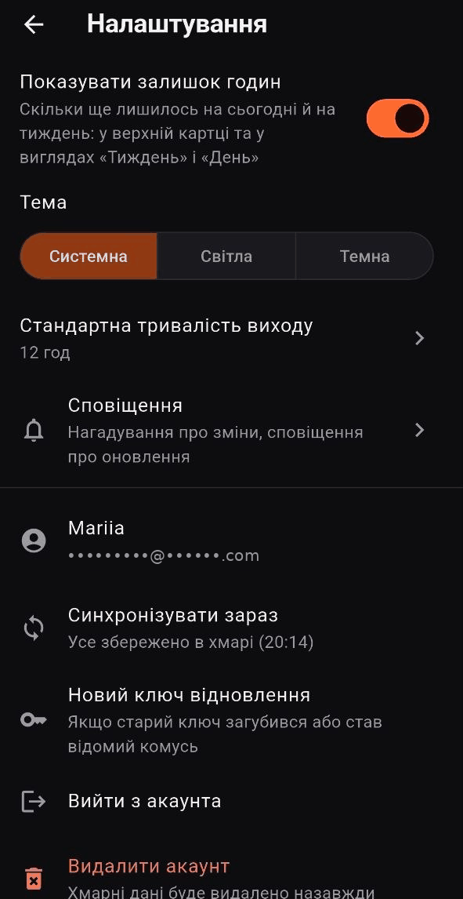<br><sub><b>Налаштування</b></sub></td>
  </tr>
</table>

- Тема: системна, світла, темна; перемикач «Показувати залишок годин».
- **Нагадування** про початок і кінець зміни (у дні, коли в календарі є вихід) з вибором часу.
- **Акаунт** за бажанням: синхронізація між телефонами, ключ відновлення, вихід, видалення акаунта.
- **Оновлення** прямо в додатку; **«Повідомити про проблему»**; перемикач автоматичних звітів про збої.

## Приватність і шифрування

- Без акаунта дані **ніколи** не залишають телефон.
- З акаунтом (пошта + пароль) дані шифруються **на телефоні** алгоритмом AES-256-GCM
  (бібліотека [`cryptography`](https://pub.dev/packages/cryptography), власних алгоритмів немає).
  У хмару потрапляє лише шифротекст.
- Для нового телефона створюється **ключ відновлення**: без нього зашифровані дані
  не прочитає ніхто, навіть розробниця. Ключ відновлення не можна скинути, тому
  його варто зберегти в надійному місці.
- У звіти про проблеми не потрапляють години й дати виходів.
- Правила доступу до хмарної бази лежать у [`firestore.rules`](firestore.rules).

## Встановлення

1. Відкрийте [**Releases**](https://github.com/MNJMARIA/work-calendar/releases/latest)
   на телефоні й завантажте файл `work-calendar.apk`.
2. Відкрийте файл. Android попросить дозволити встановлення з браузера: дозвольте.
   Якщо Play Protect покаже попередження про невідомого розробника, виберіть
   «Детальніше» → «Все одно встановити» (додаток поза Google Play).
3. Далі оновлення приходять **самі**: сповіщення «Доступне оновлення» → «Оновити».

> **OPPO / Samsung / Xiaomi.** Щоб нагадування й сповіщення приходили вчасно, увімкніть для
> додатка «Автозапуск» і зніміть обмеження батареї: Налаштування → Батарея → Робочий календар.

## Як працюють оновлення

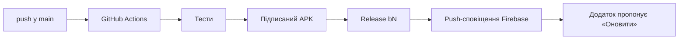

1. Push у гілку `main`. Зміни лише в `*.md` і `docs/` нову версію не випускають.
2. [`release.yml`](.github/workflows/release.yml) запускає тести, збирає підписаний APK,
   створює Release з тегом `b<номер>` і надсилає сповіщення через Firebase Cloud Messaging.
3. Додаток перевіряє `releases/latest` і пропонує кнопку «Оновити».

Усе виконується на серверах GitHub, комп'ютер розробниці може бути вимкнений.

## Технології

| Що | Чим |
| --- | --- |
| Додаток | Flutter (Dart), Material 3 |
| Локальні дані | `shared_preferences`, `flutter_secure_storage` |
| Акаунти, синхронізація | Firebase Auth, Cloud Firestore |
| Шифрування | `cryptography` (AES-256-GCM) |
| Звіти PDF | `pdf`, `printing` |
| Нагадування | `flutter_local_notifications` |
| Оновлення | GitHub Releases, `ota_update`, Firebase Cloud Messaging |
| Звіти про збої | Firebase Crashlytics |
| Збірка й випуск | GitHub Actions |

## Структура проєкту

```text
lib/
├── main.dart, app.dart          запуск, тема, нижнє меню
├── app_state.dart, logic.dart   дані, норма, розрахунки
├── calendar_page.dart           календар: місяць / тиждень / день
├── planning_page.dart           планування (чернетка)
├── export/                      PDF-звіти й архів звітів
├── notifications/               нагадування про зміни
├── account/, crypto/, sync/     акаунт, шифрування, синхронізація
├── updates/                     оновлення з GitHub Releases
└── reports/                     звіти про проблеми
test/                            автоматичні тести
.github/workflows/release.yml    збірка й випуск
firestore.rules                  правила доступу до бази
```

## Запуск для розробників

1. Встановіть [Flutter](https://docs.flutter.dev/get-started/install) і Android Studio.
2. Налаштуйте Firebase (див. нижче): у проєкті підключено плагіни Google Services і Crashlytics,
   тому для збірки потрібен файл `android/app/google-services.json`.
3. Підключіть телефон (режим розробника → «Налагодження по USB» або по Wi-Fi) і виберіть
   його у списку пристроїв Android Studio. Запуск на Windows не підтримується: це Android-додаток.
4. Виконайте:

```bash
flutter pub get
flutter run
```

Автоматичні тести (`flutter test`) Firebase не потребують.

### Налаштування Firebase і випуску

Секретні файли в репозиторій **не входять** (див. `.gitignore`).

1. Створіть проєкт у [Firebase Console](https://console.firebase.google.com/), додайте Android-додаток
   з тим самим `applicationId` і покладіть `google-services.json` у `android/app/`.
2. Увімкніть Authentication (пошта й пароль), Firestore, Cloud Messaging; опублікуйте `firestore.rules`.
3. Для випуску через GitHub Actions додайте в Settings → Secrets and variables → Actions:

| Секрет | Призначення |
| --- | --- |
| `KEYSTORE_BASE64`, `KEYSTORE_PASSWORD`, `KEY_PASSWORD`, `KEY_ALIAS` | ключ підпису APK |
| `GOOGLE_SERVICES_BASE64` | `google-services.json` у форматі base64 |
| `FIREBASE_SERVICE_ACCOUNT` | сервісний акаунт для сповіщень про оновлення |

> Файл ключа підпису (`*.jks`) і пароль зберігайте окремо від репозиторію й робіть його
> резервну копію: без нього оновлення вже встановлених додатків неможливі.

## Тести

```bash
flutter test
```

Тести покривають розрахунок норми, правило «майбутні години не рахуються», вигляди
календаря, планування, таймер, шифрування й синхронізацію двох телефонів, акаунт,
оновлення, PDF-звіти за день / тиждень / місяць, архів звітів і нагадування.
Тести запускаються автоматично перед кожним випуском: якщо хоч один червоний,
нова версія не публікується.

## Плани

- [x] Місяць / тиждень / день, таймер «Вийшов на роботу», масовий вибір днів
- [x] Планування (чернетка й прогноз)
- [x] Акаунт і синхронізація з наскрізним шифруванням
- [x] Оновлення через GitHub Releases, звіти про проблеми
- [x] PDF-звіти за день / тиждень / місяць, архів звітів
- [x] Нагадування про початок і кінець зміни
- [ ] Українські свята та норма місяця з урахуванням свят
- [ ] Типи днів: відпустка, лікарняний, відгул
- [ ] Нотатки до дня
- [ ] Підсумок переробітку й недоробітку
- [ ] Шаблони графіку (3/3, 2/2, доба/троє тощо)
- [ ] Аналітика за рік і довільний період
- [ ] Експорт CSV / Excel і резервна копія файлом
- [ ] Віджет на головному екрані
- [ ] Розрахунок зарплати
- [ ] Великий шрифт і високий контраст
- [ ] Англійська мова
- [ ] Вхід через Google
- [ ] Веб-версія та iOS

## Автор

Розробниця: **Mariia Stepanova** ([@MNJMARIA](https://github.com/MNJMARIA)).

Зауваження й ідеї: вкладка **Issues** репозиторію або «Повідомити про проблему»
в налаштуваннях додатка.

## Ліцензія

[MIT](LICENSE). Шрифти Liberation Serif розповсюджуються за ліцензією
[SIL Open Font License](https://openfontlicense.org/).
